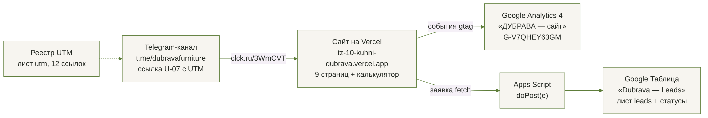
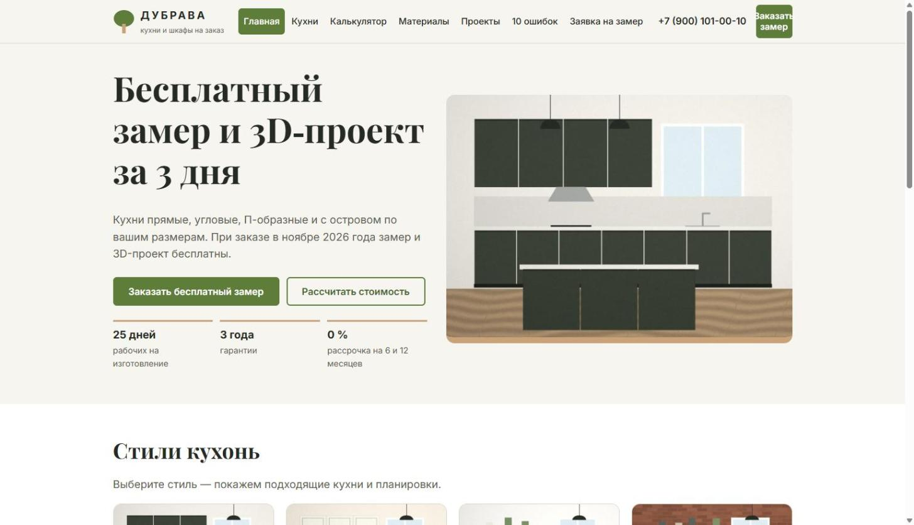
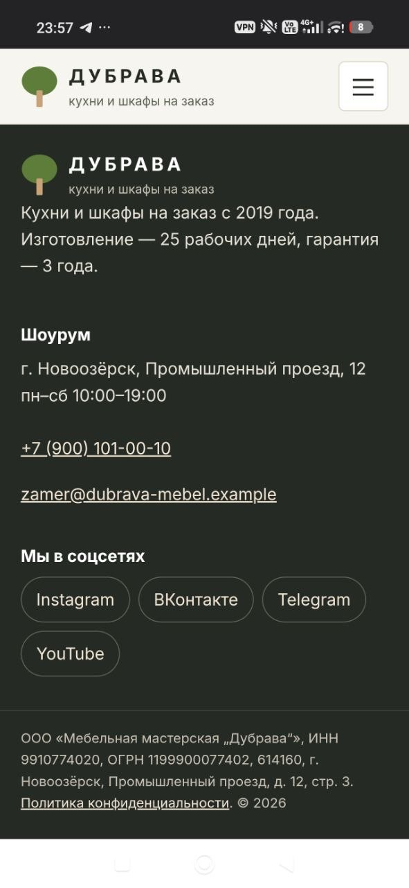
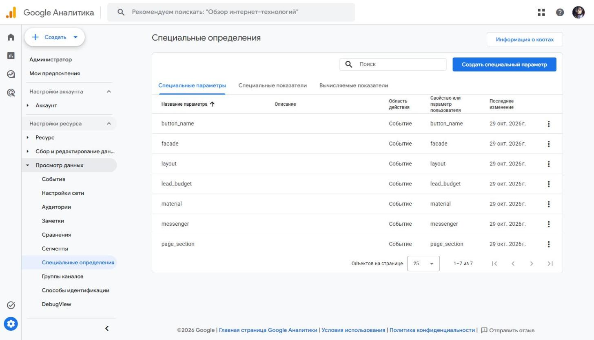
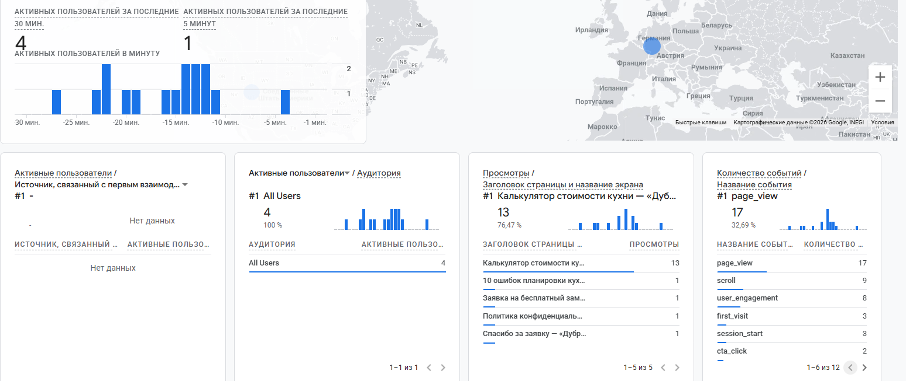
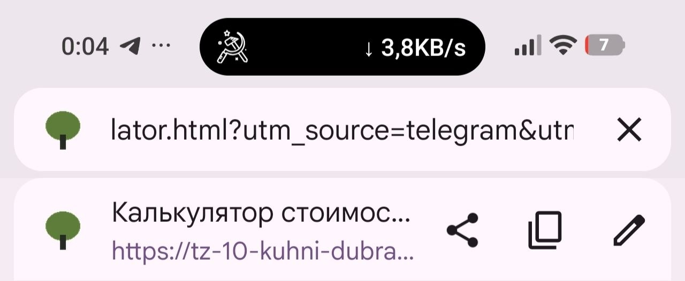
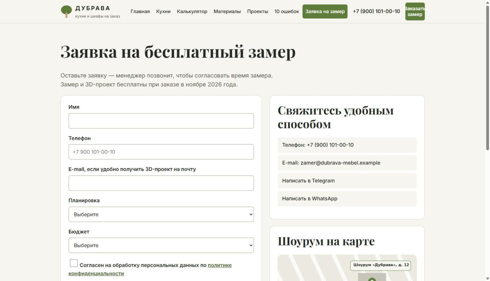
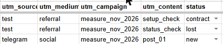

# Описание работы · ТЗ № ТЗ-10/2026 · «Дубрава»

**Исполнитель:** Коковашин Тимур Александрович, группа 11/1-РПО-26/1
**Сайт:** https://tz-10-kuhni-dubrava.vercel.app
**Период проверок:** 29.10.2026 — 30.10.2026

## 1. Задача заказчика

Мебельная мастерская «Дубрава» получает заявки на замер из Instagram, ВКонтакте и по телефону,
но не знает, какой канал приводит клиентов до договора. В сентябре 2026 года пришло 170 заявок
на замер, выполнено 96 замеров и заключено 38 договоров (письмо директора в ТЗ).
Задача — сайт, на котором видно источник каждого посетителя, и одна таблица со всеми заявками.

## 2. Схема работы

Посетитель приходит из Telegram-канала по короткой ссылке с UTM-метками.
Сайт отправляет события в GA4, а заявку — в Google Таблицу через Apps Script.
Метки сохраняются в заявке, поэтому в таблице видно, откуда пришёл клиент.

## 3. Сайт

Сайт из 9 страниц и страницы 404 создан с помощью нейросети и доработан: ___ (своими словами: что поправили вручную).
Опубликован на Vercel, обновляется после каждого push в ветку `main`.

## 4. Аналитика GA4

Создан ресурс «ДУБРАВА — сайт» (G-V7QHEY63GM), часовой пояс Москва, валюта — рубль.
В веб-потоке включена расширенная статистика с взаимодействиями с формами.
Зарегистрировано 7 пользовательских параметров: button_name, page_section, layout, facade,
material, lead_budget, messenger. Ключевые события: generate_lead, contact_click, messenger_click.

## 5. UTM-ссылки и соцсети

В реестре 12 ссылок (лист `utm` в таблице, выгрузка — `docs/utm.csv`).
Опубликована ссылка U-07 в Telegram-канале https://t.me/dubravafurniture (пост https://t.me/dubravafurniture/2),
короткая ссылка https://clck.ru/3WmCVT. Переход проверен с телефона: все метки сохраняются.

## 6. Заявки

Форма отправляет данные в Apps Script без перезагрузки страницы. Приёмник проверяет поля и
записывает строку в лист `leads` вместе с метками. Повторная отправка не создаёт дубль.
Одна тестовая заявка проведена по статусам до `contract`, другая закрыта статусом `lost`.

## 7. Автоответы в Instagram

Не выполнялось — согласовано с преподавателем.

## 8. Отчёты и дашборд

Отчёты GA4 за 24–48 часов и дашборд DataLens не выполнялись — согласовано с преподавателем
из-за срока сдачи.

## 9. Что получил бизнес

| Было | Стало |
|---|---|
| заявки в личных сообщениях и по телефону | все заявки с сайта в одной таблице со статусом |
| источник клиента неизвестен | у каждой заявки есть source, medium, campaign, content |
| цену кухни называет только менеджер | калькулятор показывает предварительную цену сразу |

Рекомендация заказчику: ___ (своими словами).

## 10. Итог

Не получилось: Instagram и ManyChat, публикации ВКонтакте, YouTube и у блогеров, отчёты GA4 и DataLens — по согласованию с преподавателем.
ИИ использовался для: генерации кода страниц, стилей и скриптов, приёмника Apps Script, иллюстраций и PDF; помощи с настройкой GA4, приёмника и реестра UTM; черновика поста для Telegram (текст переписан вручную).
